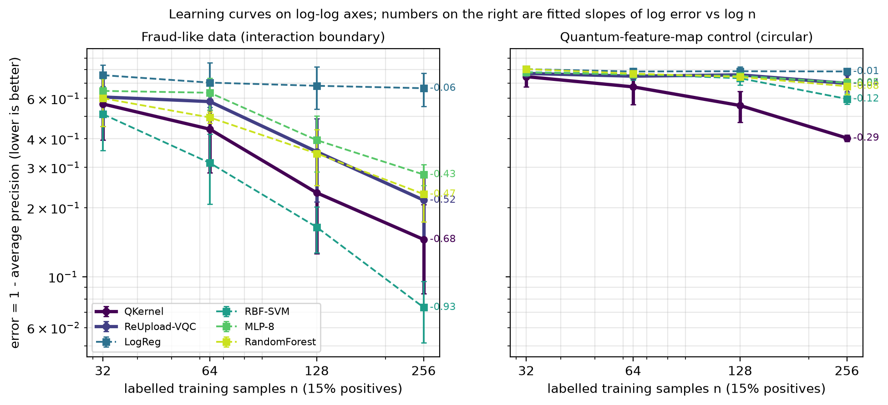
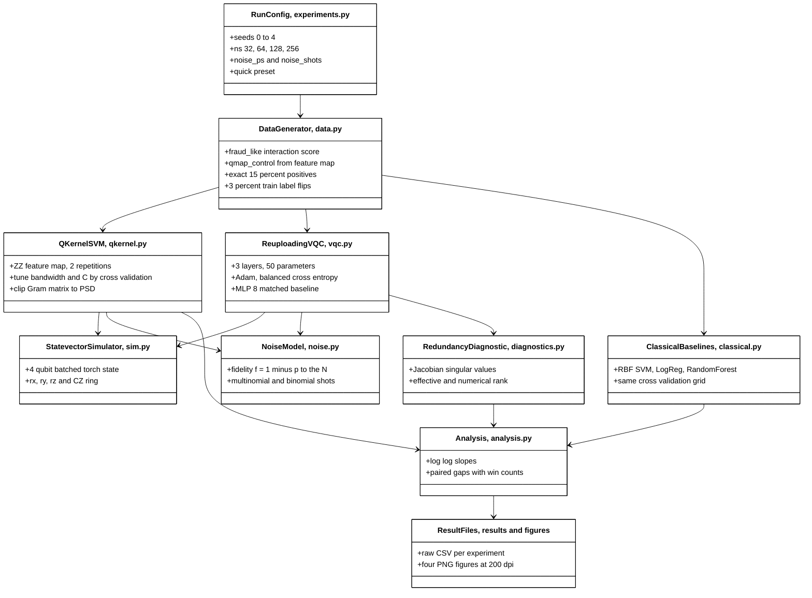
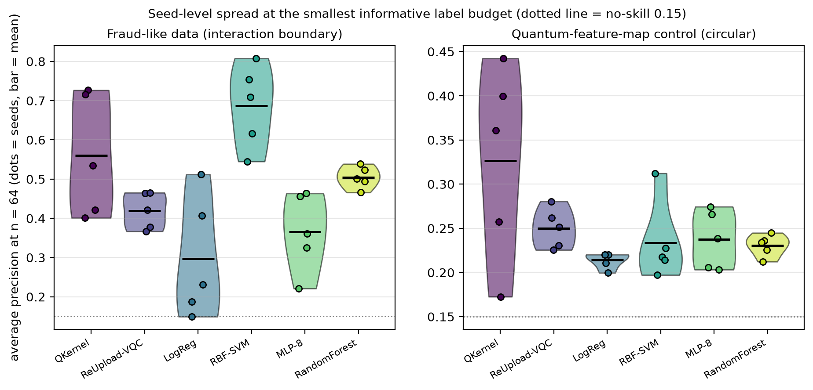
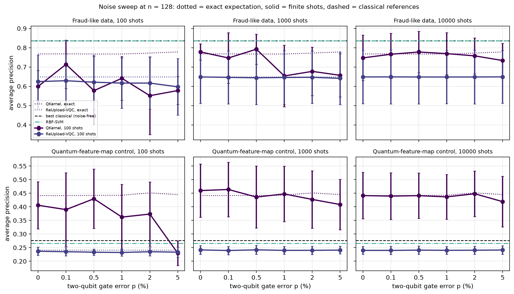
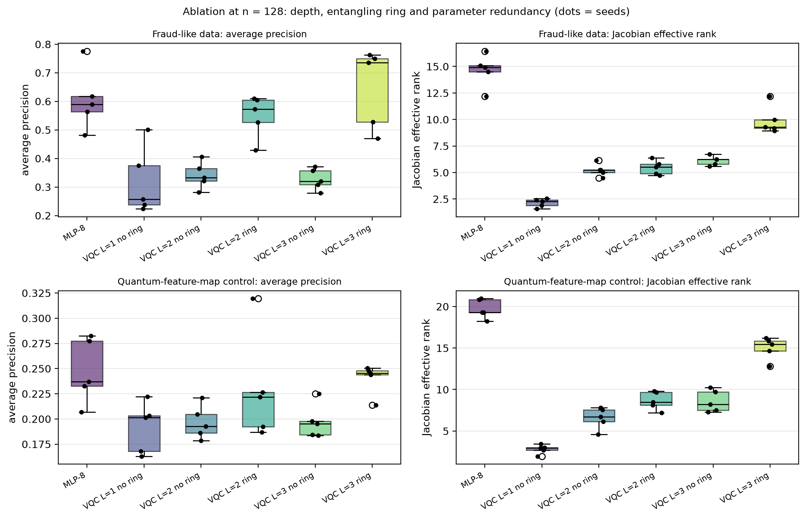

# Do small quantum classifiers help when labels are scarce? A fraud-like, class-imbalanced benchmark

[](LICENSE)
[](https://www.python.org/)
[](https://github.com/pradeepdegalaroyal/label-scarce-fraud-qml-vs-classical/actions/workflows/ci.yml)

**Abstract.** Reviews of quantum machine learning (QML) name label-limited learning as its most plausible near-term niche, but the standard quantum
classifiers are rarely tested there against equally tuned classical models. This repository benchmarks a fidelity-kernel support vector machine (SVM) and a
data re-uploading variational quantum circuit (VQC) against four classical models on synthetic, imbalanced (15% positives), fraud-like data with 32 to 256 labels,
adding a shot-noise and gate-noise sweep, an entanglement and depth ablation, and a Jacobian-rank redundancy diagnostic (4 qubits, 5 seeds, classical simulation).
**The headline result is negative:** on the fraud-like data the quantum models did not beat the tuned radial-basis-function (RBF) kernel SVM at any label budget, while a
control whose labels come from the quantum feature map itself shows the pipeline can detect a quantum benefit when one exists.

## TL;DR results (all numbers from `results/`)

Average precision (AP) on a clean test set with 15% positives (no-skill = 0.15), mean +- standard deviation over 5 seeds. Full table: `results/summary_table.md`. LogReg = logistic regression; MLP-8 = multi-layer perceptron (MLP) with 8 tanh (hyperbolic tangent) hidden units; RandomForest = random forest.

| Data set | n labelled | QKernel (quantum) | ReUpload-VQC (quantum) | RBF-SVM | MLP-8 | RandomForest | LogReg |
|---|---|---|---|---|---|---|---|
| fraud-like | 32 | 0.433 +- 0.173 | 0.392 +- 0.156 | **0.488 +- 0.157** | 0.353 +- 0.085 | 0.399 +- 0.147 | 0.242 +- 0.081 |
| fraud-like | 64 | 0.560 +- 0.156 | 0.419 +- 0.046 | **0.686 +- 0.106** | 0.365 +- 0.100 | 0.505 +- 0.028 | 0.297 +- 0.155 |
| fraud-like | 256 | 0.855 +- 0.061 | 0.784 +- 0.068 | **0.927 +- 0.022** | 0.721 +- 0.029 | 0.771 +- 0.056 | 0.336 +- 0.110 |
| quantum-map control (circular) | 64 | **0.326 +- 0.110** | 0.250 +- 0.023 | 0.234 +- 0.045 | 0.237 +- 0.033 | 0.231 +- 0.012 | 0.214 +- 0.009 |
| quantum-map control (circular) | 256 | **0.597 +- 0.013** | 0.302 +- 0.057 | 0.403 +- 0.031 | 0.298 +- 0.022 | 0.322 +- 0.054 | 0.214 +- 0.015 |

Pre-registered hypotheses (`docs/RESEARCH_GAP.md`), judged on `results/paired_gaps.csv`:

| Hypothesis | Verdict | Evidence |
|---|---|---|
| H1: best quantum model beats the best classical model at n = 32 and 64 on fraud-like data, in at least 4 of 5 seeds | **falsified** | paired AP difference +0.001 +- 0.121 (3 of 5 seeds) at n = 32 and -0.105 +- 0.162 (1 of 5) at n = 64 |
| H2: on the quantum-map control, the quantum kernel beats the RBF-SVM at small n | supported (circular by construction) | +0.034 +- 0.083 (4 of 5 seeds) at n = 32, +0.093 +- 0.086 (4 of 5) at n = 64, +0.194 +- 0.020 (5 of 5) at n = 256 |
| H3: both quantum models fall below the classical models before p = 1% two-qubit error | **falsified** | on the control the kernel stays above the best classical model (0.276 +- 0.034) up to 5% error at 1000 shots (0.408 +- 0.093); it falls below only at 5% error with 100 shots (0.229 +- 0.045). On fraud-like data both were already below at p = 0 |



*Takeaway: on the fraud-like data the RBF-SVM error falls fastest (fitted slope -0.93 against -0.68 for the quantum kernel and -0.52 for the circuit); only on the circular control does the quantum kernel learn faster than any classical model (-0.29 against -0.12).*

## What is new here

- A label-budget learning-curve benchmark of the two standard quantum baselines (fidelity kernel and data re-uploading circuit) on imbalanced, fraud-like tabular data, with equal cross-validated tuning of the kernel parameters on both sides and a parameter-matched classical network.
- A built-in positive control (labels generated from the quantum feature map) that shows when the quantum kernel wins, so a negative result on the fraud-like data cannot be blamed on a broken pipeline.
- A noise sweep that separates shot noise from depolarising-fidelity loss, and states the circuit-execution cost of the kernel (one circuit per Gram entry).
- A Jacobian effective-rank diagnostic of parameter redundancy for the circuit and the matched network, a simple version of the redundancy argument made for quantum reinforcement learning by Alzboun and Abed-alguni (2027).

## Method



*Legend: CZ = controlled-Z gate; PSD = positive semi-definite; MLP = multi-layer perceptron; RBF = radial basis function; SVM = support vector machine; LogReg = logistic regression; Adam = adaptive moment estimation optimiser; CSV = comma-separated values; PNG = portable network graphics; dpi = dots per inch.*

**Summary.** Both data sets have four features, one per qubit. The *fraud-like* set is classical by design: the label depends on the products x0*x1 and x2*x3, so a linear model fails.
The *quantum-map control* takes labels from a random observable measured on the kernel's own feature-map state. The *QKernel* tunes feature-map bandwidth (0.5, 1, 2) and the SVM penalty C
by 3-fold cross-validation on AP. The *ReUpload-VQC* re-encodes the features in every one of 3 layers with trainable scales and rotations (50 parameters),
joined by a ring of controlled-Z (CZ) gates between layers (8 CZ in total), and is read out as the mean of the Pauli-Z expectations. It is compared with an 8-unit tanh multi-layer perceptron
(MLP-8, 49 parameters) trained with the identical optimiser, epochs, loss and restarts. The RBF-SVM receives the same cross-validation budget as the kernel. Noise is an effective global-depolarising model with
fidelity (1 - p)^N for N two-qubit gates (8 for the circuit, 32 for the kernel's compute-uncompute circuit), plus exact multinomial or binomial shot sampling. Details: `docs/METHOD.md`.

## Motivation and research gap

Surveys of QML (Peral-García et al., 2024, doi:10.1016/j.cosrev.2024.100619; Zeguendry et al., 2023, doi:10.3390/e25020287) report mostly small, balanced benchmarks, and Abbas et al. (2024, doi:10.1038/s42254-024-00770-9) call for systematic benchmarking against strong classical solvers.
Jerbi et al. (2023, doi:10.1038/s41467-023-36159-y) identify kernel and data re-uploading models as the standard families and prove resource separations between them. A 2026 review of QML for remote sensing concludes that QML at best matches strong classical baselines,
with label-limited learning the most plausible niche (Bhullar et al., 2027, doi:10.1016/j.compag.2026.112376), and a 2026 diagnostic study traces the quantum shortfall in reinforcement learning to ill-conditioning and parameter redundancy
(Alzboun and Abed-alguni, 2027, doi:10.1016/j.ins.2026.124009). **Gap:** none of the supplied papers measures the label-limited claim for the standard quantum baselines on imbalanced fraud-like data under equal tuning, shot noise and a parameter-matched classical model.
The related-work table with 13 papers is in `docs/RESEARCH_GAP.md`. Payment fraud is the motivating application (rare positives, few trusted labels); the data here are synthetic and say nothing about real transactions.

## Results in detail



*Takeaway: at n = 64 the seed-to-seed spread of the quantum kernel (AP 0.560 +- 0.156) is wide enough to overlap the RBF-SVM (0.686 +- 0.106), yet it beat the RBF-SVM in only 1 of 5 seeds.*

**Learning curves.** Fitted log-log slopes (`results/learning_slopes.csv`) on fraud-like data: RBF-SVM -0.933, QKernel -0.681, ReUpload-VQC -0.521, RandomForest -0.469, MLP-8 -0.432, LogReg -0.061 (a linear model cannot represent the interaction).
On the control: QKernel -0.294, RBF-SVM -0.122, the others between -0.010 and -0.079. The one comparison in which the quantum side leads consistently is the circuit against its parameter-matched network on fraud-like data:
the paired difference ReUpload-VQC minus MLP-8 is +0.038, +0.054, +0.043 and +0.063 AP at n = 32, 64, 128, 256 (3, 4, 2 and 5 of 5 seeds), with a standard deviation of 0.04 to 0.12 per seed, so only the n = 256 point is clearly separated from zero.



*Takeaway: gate error barely matters for ranking (a global depolarising channel only rescales the signal); finite shots do, and the kernel is far more exposed than the circuit.*

**Noise.** On fraud-like data at n = 128, the kernel drops from 0.768 +- 0.107 (exact) to 0.599 +- 0.082 with 100 shots per Gram entry at p = 0, and to 0.578 +- 0.072 at p = 5%; with 10000 shots it stays at 0.734 +- 0.089 at p = 5%.
The circuit moves little (0.649 +- 0.139 exact, 0.597 +- 0.146 at p = 5% with 100 shots) because it averages four measured qubits per shot. The kernel's shot count is per Gram entry, so a test point costs n_train x shots circuit executions
(12,800 at n = 128 and 100 shots) against 100 for the circuit; that asymmetry is not equalised in the plot. Best classical AP at n = 128: 0.835 +- 0.037 (fraud-like), 0.276 +- 0.034 (control).



*Takeaway: the entangling ring is what lets the circuit represent feature interactions (AP 0.649 against 0.327 without it), but the circuit uses fewer effective directions per parameter than the matched network.*

**Ablation and redundancy (n = 128, fraud-like).** One layer: 0.319 +- 0.118; three layers without the ring: 0.327 +- 0.037; two layers with ring: 0.548 +- 0.074; three layers with ring: 0.649 +- 0.139; MLP-8: 0.606 +- 0.108.
The Jacobian effective rank is 9.9 +- 1.3 for the 50-parameter circuit (numerical rank 40.4 +- 1.5) against 14.6 +- 1.5 for the 49-parameter MLP-8 (numerical rank 46.2 +- 1.3), so about 20% versus 30% of parameters act as independent directions
(`results/ablation_summary.csv`). This agrees in direction with the redundancy explanation of Alzboun and Abed-alguni (2027) but does not prove it causal here.

## Discussion, including negative results

- **H1 failed.** The RBF-SVM is the best model at every label budget on the fraud-like data, with a margin over the quantum kernel of 0.055 to 0.127 AP; the best-quantum minus best-classical difference is +0.001 at n = 32 (a tie) and negative from n = 64 on. Scarcity did not rescue the quantum models here.
- **H2 held, with a caveat.** The quantum kernel wins on its own feature map by +0.194 AP at n = 256, but the circuit (a different ansatz) does not, so even "quantum-friendly" labels do not help every quantum model; the control is circular and is not evidence of advantage.
- **H3 failed in an interesting way.** Under this effective noise model the kernel's advantage on the control survives 5% two-qubit error at 1000 or more shots; the binding constraint is shot count, not gate fidelity.
- The circuit-versus-MLP advantage is small and may reflect the MLP's optimisation budget (150 epochs, 2 restarts, no tuning of width or learning rate); the MLP was not tuned beyond the shared budget.

## Limitations

Synthetic data, four features, four qubits, classical simulation; no real transaction data and no hardware. The noise model is a global-depolarising effective model with trained-noise-free circuit parameters, and it ignores coherent and crosstalk errors, so it is optimistic.
Five seeds give wide standard deviations at small n; paired differences below about 0.1 AP are not resolved. One feature map, one ansatz and one observable were tested; the quantum kernel bandwidth grid has three values.
The fraud score was chosen by the author and a different classical or quantum-friendly structure could change the ordering.

## Future work and scaling to real hardware

Replace the effective noise model by transpiled circuits on a noisy simulator or a device, with shot-budget parity between kernel and circuit; test projected quantum kernels and trained feature maps; widen the classical set (gradient boosting, tuned MLP);
use real, anonymised fraud data with a label-budget protocol; scale beyond 4 features through dimensionality reduction and study how the redundancy diagnostic changes with qubit count.

## Reproducibility

```bash
pip install -r requirements.txt        # Python 3.11; no GPU needed
pytest -q                              # 9 tests
python experiments/run_all.py --quick  # smoke run, about 45 s of compute (about 70 s wall-clock on a busy laptop)
python experiments/run_all.py          # full run: 838 s of compute (about 14.5 min wall-clock)
```

Hardware used: Windows 11 laptop, 16 threads, central processing unit (CPU) only (3 worker processes with 2 torch threads each). The quick run writes to `results_quick/` and `figures_quick/`; the full run writes `results/*.csv|json|md` and `figures/*.png`.
Seeds 0 to 4 control data, splits, initialisations and shot sampling, so the numbers above should regenerate on the pinned library versions (`requirements.txt`), up to floating-point and threading differences.

## Project structure

```
src/scarcelabel/   sim.py, data.py, noise.py, qkernel.py, vqc.py, classical.py, diagnostics.py, experiments.py, analysis.py, plots.py
experiments/       run_all.py (one command for every result and figure)
tests/             test_core.py (simulator, data, noise model, circuit, diagnostics)
docs/              RESEARCH_GAP.md, METHOD.md
results/           raw and summary CSV files, summary_table.md, config.json
figures/           fig1 to fig4 (200 dpi)
.github/workflows/ ci.yml (pytest and quick run on ubuntu-latest)
```

## Related work by the author

- [qaoa-best-of-k-sampling-noise](https://github.com/pradeepdegalaroyal/qaoa-best-of-k-sampling-noise): the same habit of equal-budget baselines and noise sweeps, applied to the Quantum Approximate Optimization Algorithm (QAOA) instead of classification.
- [QFM-HeartBench](https://github.com/pradeepdegalaroyal/QFM-HeartBench): quantum feature-map benchmarking for clinical classification with nested cross-validation; this project asks the complementary label-budget and imbalance question on synthetic data.

## Citation

```bibtex
@software{degala_label_scarce_fraud_qml_2026,
  author   = {Degala, Chenchupradeep},
  title    = {Label-scarce, class-imbalanced benchmark of quantum and classical classifiers (fraud-like data, simulation)},
  year     = {2026},
  version  = {0.1.0},
  url      = {https://github.com/pradeepdegalaroyal/label-scarce-fraud-qml-vs-classical},
  license  = {MIT}
}
```

MIT license (`LICENSE`). See also `CITATION.cff`.
